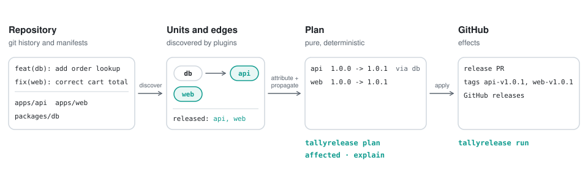
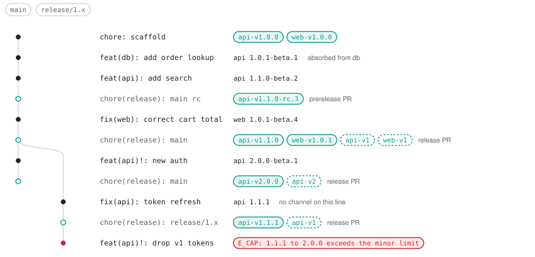
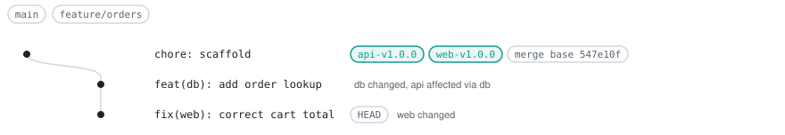

<p align="center">
  <picture>
    <source media="(prefers-color-scheme: dark)" srcset="docs/assets/logo-dark.svg">
    
  </picture>
</p>

<p align="center">Know what changed. Release what matters.</p>

<p align="center">
  <a href="https://www.npmjs.com/package/@tallyrelease/cli"></a>
  <a href="https://github.com/abinnovision/tallyrelease/actions/workflows/ci.yaml"></a>
  <a href="LICENSE"></a>
  <a href="https://nodejs.org">=24"></a>
</p>

<p align="center">
  <a href="#quick-start">Quick start</a> · <a href="#documentation">Documentation</a> · <a href="#comparison">Comparison</a>
</p>

tallyrelease reads git history, Conventional Commits and a dependency graph supplied by ecosystem plugins. From that it computes which units a change affects (the build set) and which units release at what version (the plan). It then runs the release effects on GitHub: version files, changelogs, release PRs, tags and GitHub releases. It works for monorepos and single repos.

> [!WARNING]
> tallyrelease is in beta. Until 1.0, any `0.x` minor release may contain breaking changes to config, CLI flags and outputs. Pin an exact version and read the [changelog](packages/cli/CHANGELOG.md) before upgrading.

## Features

### Know what changed

- **One graph for builds and releases.** The same units and edges decide what CI builds and which units get a new version.
- **Affected builds in any CI.** `affected` lists the changed units and their dependents as text, TSV, JSON or a GitHub Actions matrix.
- **Explainable.** `explain` shows why a unit is affected and which commits bump it.

### Release what matters

- **Build-only units.** A change in an internal package is absorbed into the released units that depend on it, as a patch by default.
- **Release PRs.** A merged release PR is tagged only after the plan is re-checked against it.
- **Maintenance lines.** Branch rules cap bumps on a line and report the commits that would leave it.
- **Prereleases.** Build prereleases are numbered from git history with nothing written to the repo, and merging a prerelease PR cuts one.
- **Preview before writing.** `plan` and `--dry-run` show versions, bumps and the commits behind them.

Not included: tallyrelease does not publish to registries; it hands a [release list](docs/release-list.md) to your publishers. Release effects need GitHub, while `affected` works in any CI with `--base`.

## How it works

<p align="center">
  <picture>
    <source media="(prefers-color-scheme: dark)" srcset="docs/assets/how-it-works-dark.svg">
    
  </picture>
</p>

Plugins discover units and the edges between them. tallyrelease attributes each commit to units by path, walks the graph to find dependents, and turns the result into a build set and a release plan per branch line. The cli applies the plan as effects on GitHub, and your existing pipelines build and publish what it lists.

## The release cycle

On every push to a line branch, `tallyrelease run` tags merged release PRs, plans HEAD and opens or updates the release PRs. The history below runs the example with a build channel, a cut channel, a maintenance rule and floating tags:

```yaml
branches:
  - { name: main, line: default, channels: { build: beta, cut: rc } }
  - { name: "release/{major}.x", line: maintenance }
tags:
  floating: ["{id}-v{major}"]
```

<p align="center">
  <picture>
    <source media="(prefers-color-scheme: dark)" srcset="docs/assets/release-cycle-dark.svg">
    
  </picture>
</p>

- Every push gets a build prerelease version, `{next}-beta.{N}`, where N counts first-parent commits since the last stable release. Nothing is tagged or written.
- Merging the prerelease PR cuts `1.1.0-rc.3`: a tag and a GitHub prerelease, no version file changes.
- Merging the release PR tags the merge commit and creates the GitHub releases. The plan is recomputed at the merge, so a PR that no longer matches is labelled stale and nothing is tagged.
- Floating tags follow the highest stable release of each major, so `api-v1` moves with the maintenance line.
- A maintenance rule caps bumps on `release/1.x` at minor and names the offending commit.

See [Releasing](docs/releasing.md) for each case and [Recipes](docs/recipes.md) for step-by-step histories.

## Quick start

Install the cli:

```sh
npm i -D @tallyrelease/cli
# or run without installing
npx @tallyrelease/cli check
```

The examples below use an npm workspaces repo with `apps/api` (depends on `packages/db`), `apps/web` and `packages/db`. Create `tallyrelease.yaml` at the repository root:

```yaml
# yaml-language-server: $schema=./node_modules/@tallyrelease/cli/dist/tallyrelease.schema.json
plugins:
  node: {}
units:
  apps/api: { release: true }
  apps/web: { release: true }
branches:
  - { name: main, line: default }
```

Validate the config, units and graph:

```text
$ tallyrelease check
ok: 3 units (2 released: api, web), 1 edge
```

On a feature branch, see what the change affects:

```text
$ tallyrelease affected
base  547e10f (merge base with main)

direct (2)
  db   packages/db
  web  apps/web             released
dependent (1)
  api  apps/api     via db  released

3 of 3 units affected
```

<p align="center">
  <picture>
    <source media="(prefers-color-scheme: dark)" srcset="docs/assets/feature-branch-dark.svg">
    
  </picture>
</p>

See what would release when it merges:

```text
$ tallyrelease plan --branch main
branch  main (rule main, default line)
base    547e10f (merge base with main)

UNIT  KIND     FROM   BUMP   NEXT   VERSION
db    rebuild  -      -      -      -
api   rebuild  1.0.0  patch  1.0.1  -
web   rebuild  1.0.0  patch  1.0.1  -

3 units planned: 3 rebuild
```

See why `api` releases:

```text
$ tallyrelease explain api --branch main
api  apps/api  node  semver
base    547e10f (merge base with main)

affected  dependent via db
release   1.0.0 -> 1.0.1 (patch)
  base tag api-v1.0.0

changes (1)
  acdcd7d  feat  add order lookup  via db
      packages/db/src/index.js
```

In GitHub Actions, run `tallyrelease run` on pushes to `main`:

```yaml
on:
  push:
    branches: [main]
concurrency:
  group: release-${{ github.ref }}
jobs:
  release:
    runs-on: ubuntu-latest
    permissions:
      actions: read
      contents: write
      pull-requests: write
      issues: write
    steps:
      - uses: actions/checkout@v4
        with:
          fetch-depth: 0
      - run: npx @tallyrelease/cli run --github-output
        env:
          GITHUB_TOKEN: ${{ github.token }}
```

See [CI](docs/ci.md) for the build matrix, the outputs and token choices.

## Documentation

- Start
  - [Getting started](docs/getting-started.md): install, configure and run the first commands.
- Understand
  - [Concepts](docs/concepts.md): units, edges, groups, lines and the plan.
  - [Releasing](docs/releasing.md): release PRs, maintenance lines and prereleases.
  - [Recipes](docs/recipes.md): step-by-step guides for common setups.
- Operate
  - [CI](docs/ci.md): GitHub Actions setup, outputs and tokens.
  - [Plugin authoring guide](docs/plugins.md): write a plugin for another ecosystem.
  - Built-in plugins: [node](docs/plugins/node.md), [php](docs/plugins/php.md), [go](docs/plugins/go.md), [kustomize](docs/plugins/kustomize.md), [dart](docs/plugins/dart.md), [changesets](docs/plugins/changesets.md), [config-only](docs/plugins/config-only.md).
- Reference
  - [CLI](docs/cli.md): every command and flag.
  - [Configuration](docs/configuration.md): every key of `tallyrelease.yaml`.
  - [Release list](docs/release-list.md): fields of the `releases` output.
  - [Errors and warnings](docs/errors.md): cause and fix of every code.
- Project
  - [Comparison](docs/comparison.md): next to release-please and Changesets.
  - [Design](docs/design.md): the internal specification.

## Comparison

|                  | tallyrelease                                 | release-please                 | Changesets         |
| :--------------- | :------------------------------------------- | :----------------------------- | :----------------- |
| Release intent   | Conventional Commits                         | Conventional Commits           | `.changeset` files |
| Dependency graph | Plugin graph with propagation and absorption | Paths plus workspace plugins   | Workspace graph    |
| Affected builds  | Yes                                          | No                             | No                 |
| Prereleases      | Per branch, no committed state               | Prerelease versioning strategy | Repo-wide pre mode |
| Publishing       | No, hands over a release list                | No                             | npm                |

Choose release-please if you need one of its many release types or linked versions. Choose Changesets if you want publishing built in, snapshot releases or hand-written release notes. tallyrelease does not replace turbo, Nx or moon. It answers "what changed and what releases"; task runners still run the builds, and the two can be used together. See [Comparison](docs/comparison.md) for the full table.

## Status

This repository releases itself with tallyrelease, with `@tallyrelease/core`, `@tallyrelease/cli` and `@tallyrelease/plugins` as one fixed group.

## Contributing

See [CONTRIBUTING.md](CONTRIBUTING.md). Set up with `make setup-dev`, then run `yarn check` and `yarn test-unit` before opening a pull request.

## Acknowledgements

[release-please](https://github.com/googleapis/release-please) shaped the release PR flow, the changelog format and the tag names, and [Changesets](https://changesets.dev) informed groups and release intent. Affected builds borrow from task runners such as [turbo](https://turborepo.com), [Nx](https://nx.dev) and [moon](https://moonrepo.dev).

tallyrelease was designed and written with help from AI coding assistants. The maintainers review the design, code and tests and are responsible for them.

## Licence

Apache-2.0, see [LICENSE](LICENSE).
