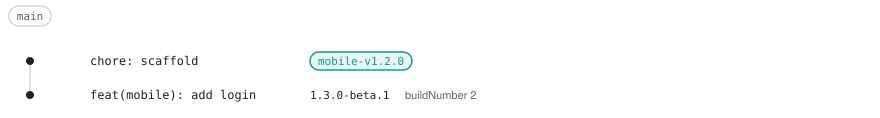
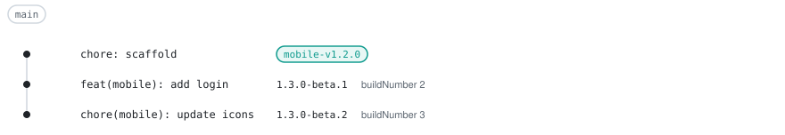
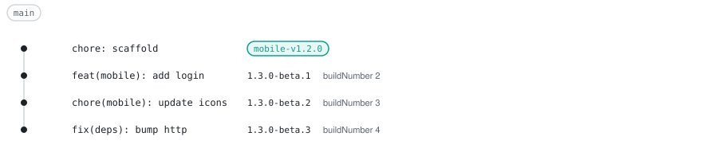
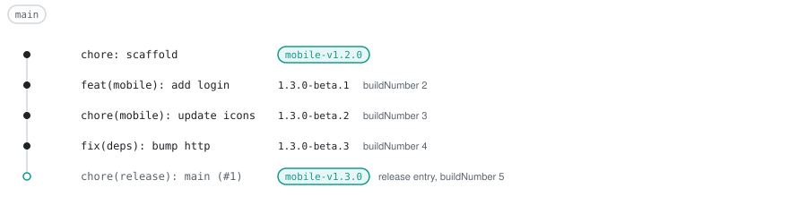
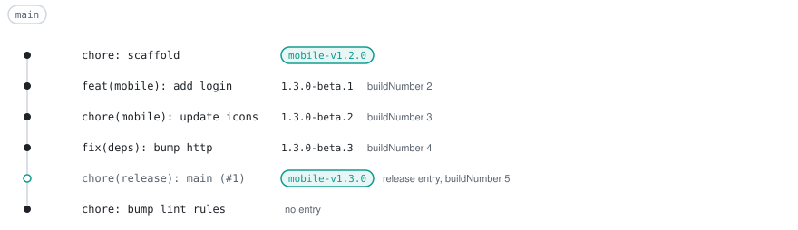
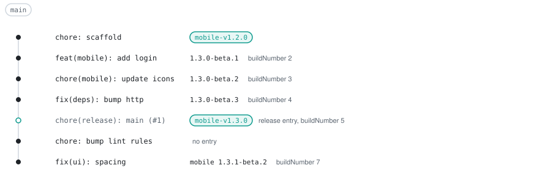

# Mobile apps

A Flutter app keeps a semver version that tallyrelease plans, and the store build number comes from the [release list](release-list.md). The build number is never part of the version. The [`dart`](plugins/dart.md) plugin reads and writes `pubspec.yaml`.

## Repository layout

The repository is a pub workspace. `apps/mobile` is released and `packages/*` are build-only. Flavors such as `staging` and `prod` are plain Flutter flavors, and tallyrelease does not know about them.

```text
pubspec.yaml            # workspace: [apps/mobile, packages/ui], no version
apps/mobile/pubspec.yaml
packages/ui/pubspec.yaml
tallyrelease.yaml
```

## Configure

```yaml
# tallyrelease.yaml
plugins:
  dart: {}
units:
  apps/mobile: { release: true, buildNumber: { offset: 0 } }
branches:
  - { name: main, line: default, channels: { build: beta } }
```

`buildNumber` adds the build number to the release list. Set `offset` to continue above the builds already uploaded to the stores. The release PR writes `version: 1.3.0` to `apps/mobile/pubspec.yaml` and drops any `+build` suffix.

## Versions and build numbers

| Release list                 | Flutter flag     | Store field                                 |
| :--------------------------- | :--------------- | :------------------------------------------ |
| `version`, without `-beta.N` | `--build-name`   | `versionName`, `CFBundleShortVersionString` |
| `buildNumber`                | `--build-number` | `versionCode`, `CFBundleVersion`            |

A prerelease entry has the version `1.3.0-beta.N`, so the workflow strips the suffix for `--build-name`.

`buildNumber` is the first-parent commit count of `releaseSha` plus `offset`. It grows with every commit on `main`, and the release commit comes after every staging build of its cycle, so the release build number is higher than the staging builds it ships. `N` in `beta.N` counts commits since the last release tag and is a different number.

The version has no `+build` suffix. A version that changes on every push would rebuild the release PR on every push (see [design](design.md) A.5).

## Walkthrough

`mobile` is at 1.2.0, tagged `mobile-v1.2.0`, on the first commit of `main`. Each step shows the entry that `run --github-output` lists after the push.

<p align="center">
  <picture>
    <source media="(prefers-color-scheme: dark)" srcset="assets/mobile-scaffold-dark.svg">
    
  </picture>
</p>

### A feature

A `feat` gives a minor prerelease. The staging entry is `1.3.0-beta.1` with `buildNumber` 2.

<p align="center">
  <picture>
    <source media="(prefers-color-scheme: dark)" srcset="assets/mobile-feature-dark.svg">
    
  </picture>
</p>

### A chore

While a releasable commit is pending, every push that affects `mobile` gives a new entry. The `chore` adds no bump, but the prerelease stays, so it is `1.3.0-beta.2` with `buildNumber` 3.

<p align="center">
  <picture>
    <source media="(prefers-color-scheme: dark)" srcset="assets/mobile-chore-dark.svg">
    
  </picture>
</p>

### A dependency fix

Configure Dependabot or Renovate to prefix runtime dependencies with `fix(deps)` and dev dependencies with `chore(deps)`. The `feat` already gives a minor, so the bump stays.

<p align="center">
  <picture>
    <source media="(prefers-color-scheme: dark)" srcset="assets/mobile-deps-dark.svg">
    
  </picture>
</p>

```text
$ tallyrelease plan --base mobile-v1.2.0
branch  main (rule main, default line, channel beta)
base    c992553 (--base mobile-v1.2.0)

UNIT    KIND        FROM   BUMP   NEXT   VERSION
mobile  prerelease  1.2.0  minor  1.3.0  1.3.0-beta.3

1 unit planned: 1 prerelease
```

### Merge the release PR

Merging the release PR tags the merge commit. The entry is `kind: release`, `version: 1.3.0`, `buildNumber` 5, and has no prerelease entry next to it.

<p align="center">
  <picture>
    <source media="(prefers-color-scheme: dark)" srcset="assets/mobile-release-dark.svg">
    
  </picture>
</p>

### After the release

A `chore` after the release gives no entry, so nothing is built.

<p align="center">
  <picture>
    <source media="(prefers-color-scheme: dark)" srcset="assets/mobile-chore-after-dark.svg">
    
  </picture>
</p>

A `fix` in `packages/ui` is absorbed into `mobile` as a patch, because `ui` is build-only and `mobile` depends on it (see [concepts](concepts.md#released-and-build-only-units)). The entry is `1.3.1-beta.2` with `buildNumber` 7.

<p align="center">
  <picture>
    <source media="(prefers-color-scheme: dark)" srcset="assets/mobile-absorbed-dark.svg">
    
  </picture>
</p>

## Workflow

The workflow extends the `release` job from [CI](ci.md#releases). A `jq` step splits `releases` into the staging and prod entries, since Actions expressions cannot filter arrays. Each build job checks out `releaseSha` with the full history, because `buildNumber` counts commits and a shallow clone fails with `E_BUILD_NUMBER_SHALLOW`.

```yaml
name: release
on:
  push:
    branches: [main]
permissions:
  actions: read
  contents: write
  pull-requests: write
  issues: write
concurrency:
  group: release-${{ github.ref }}
  cancel-in-progress: false
jobs:
  release:
    runs-on: ubuntu-latest
    outputs:
      staging: ${{ steps.split.outputs.staging }}
      prod: ${{ steps.split.outputs.prod }}
    steps:
      - uses: actions/checkout@v4
        with:
          fetch-depth: 0
      - id: run
        run: npx @tallyrelease/cli run --github-output --summary
        env:
          GITHUB_TOKEN: ${{ secrets.GITHUB_TOKEN }}
          GIT_AUTHOR_NAME: github-actions[bot]
          GIT_AUTHOR_EMAIL: 41898282+github-actions[bot]@users.noreply.github.com
      - id: split
        env:
          RELEASES: ${{ steps.run.outputs.releases }}
        run: |
          echo "staging=$(jq -c 'map(select(.kind == "prerelease"))' <<<"$RELEASES")" >> "$GITHUB_OUTPUT"
          echo "prod=$(jq -c 'map(select(.kind == "release"))' <<<"$RELEASES")" >> "$GITHUB_OUTPUT"
  staging:
    needs: release
    if: needs.release.outputs.staging != '[]'
    strategy:
      matrix:
        release: ${{ fromJSON(needs.release.outputs.staging) }}
    runs-on: ubuntu-latest
    steps:
      - uses: actions/checkout@v4
        with:
          ref: ${{ matrix.release.releaseSha }}
          fetch-depth: 0
      - uses: subosito/flutter-action@v2
      - env:
          VERSION: ${{ matrix.release.version }}
        run: |
          cd ${{ matrix.release.path }}
          flutter build appbundle --flavor staging \
            --build-name "${VERSION%%-*}" \
            --build-number ${{ matrix.release.buildNumber }}
      - run: echo upload
  prod:
    needs: release
    if: needs.release.outputs.prod != '[]'
    strategy:
      matrix:
        release: ${{ fromJSON(needs.release.outputs.prod) }}
    runs-on: ubuntu-latest
    steps:
      - uses: actions/checkout@v4
        with:
          ref: ${{ matrix.release.releaseSha }}
          fetch-depth: 0
      - uses: subosito/flutter-action@v2
      - run: |
          cd ${{ matrix.release.path }}
          flutter build appbundle --flavor prod \
            --build-name ${{ matrix.release.version }} \
            --build-number ${{ matrix.release.buildNumber }}
      - run: echo upload
```

Entries with `catchUp: true` are not built from HEAD, so the checkout of `releaseSha` matters for them. iOS builds need a macOS runner.

## Gotchas

- A release or prerelease on a maintenance branch repeats build numbers (`W_BUILD_NUMBER_MAINTENANCE`). Upload `max(N, latest store build + 1)`, or fix forward on `main`.
- Build numbers count the first-parent commits of each branch, so staging builds from another branch can repeat numbers already uploaded from `main`. Upload staging builds only from `main`.
- An unreleased package with an exact pin on a released one keeps the old pin, and `pub get` fails after the release. Use `^` or `any` there (see [dart](plugins/dart.md#version-files)).
- A change to `pubspec.lock` is a global input. It rebuilds every unit and gives no bump.
