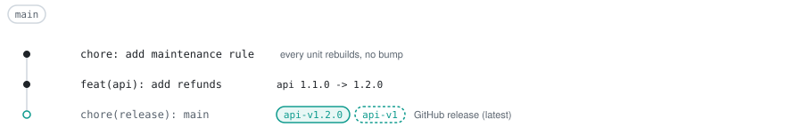
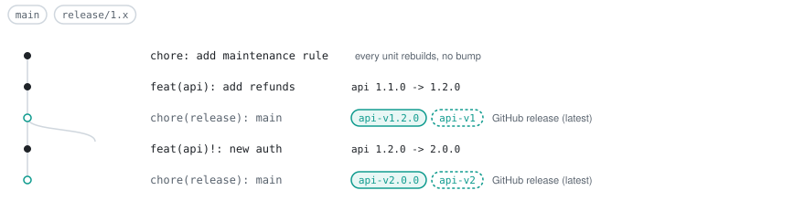
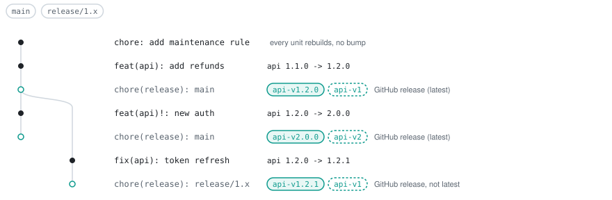
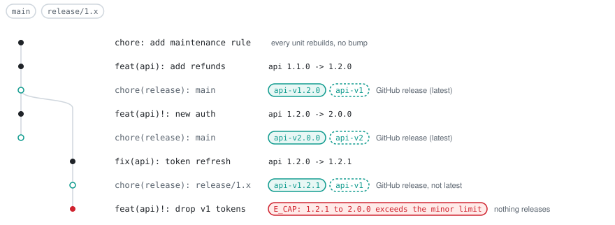
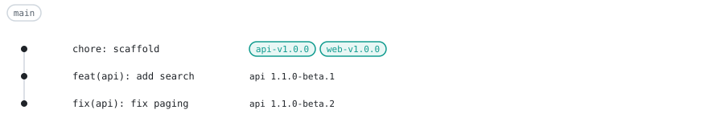
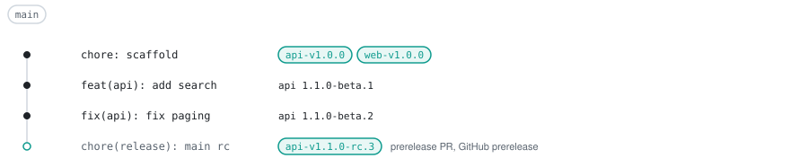
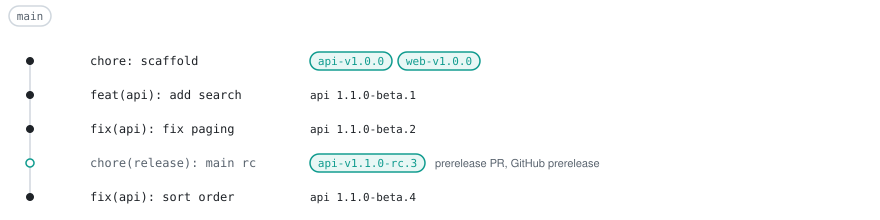
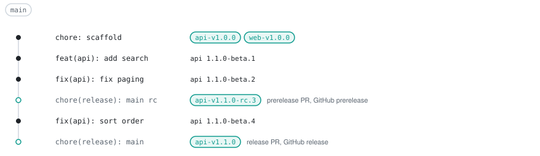
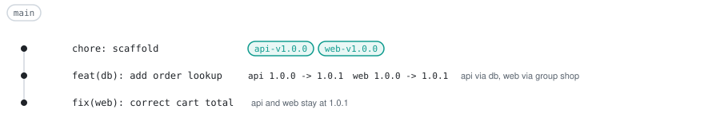
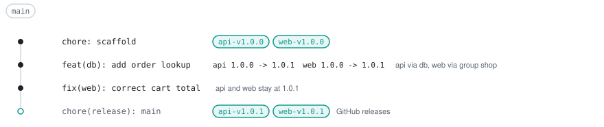

# Recipes

These are step-by-step walkthroughs on the running example from [concepts.md](concepts.md); each step shows the git history after it, annotated with what tallyrelease does.

## Maintenance line

`api` is at 1.1.0 on `main`. The goal is to release 2.0.0 on `main` and keep shipping fixes for 1.x.

```yaml
# tallyrelease.yaml
plugins:
  node: {}
units:
  apps/api: { release: true }
  apps/web: { release: true }
branches:
  - { name: main, line: default }
  - { name: "release/{major}.x", line: maintenance }
tags:
  floating: ["{id}-v{major}"]
```

### Add the branch rule

Commit the rule on `main` before the release you want to maintain, so the maintenance branch carries it. `tallyrelease.yaml` is a global input, so every unit rebuilds, and a `chore` commit gives no bump.

<p align="center">
  <picture>
    <source media="(prefers-color-scheme: dark)" srcset="assets/maintenance-line-rule-dark.svg">
    
  </picture>
</p>

### Release 1.2.0

A `feat` opens the release PR for 1.2.0. Merging it tags the merge commit.

<p align="center">
  <picture>
    <source media="(prefers-color-scheme: dark)" srcset="assets/maintenance-line-release-1-2-0-dark.svg">
    
  </picture>
</p>

### Start the maintenance line

Push the last 1.x release as a branch. The branch matches `release/{major}.x`, so bumps on it are capped at minor. This also works later: when a maintenance rule with `{major}` and no `*` exists for the item, the release PR of the next major suggests the same command.

```sh
git push origin api-v1.2.0:refs/heads/release/1.x
```

<p align="center">
  <picture>
    <source media="(prefers-color-scheme: dark)" srcset="assets/maintenance-line-branch-dark.svg">
    
  </picture>
</p>

### Release 2.0.0

A breaking change on `main` gives a major. Merging its release PR tags 2.0.0 and creates the floating tag `api-v2`; `api-v1` stays at 1.2.0.

<p align="center">
  <picture>
    <source media="(prefers-color-scheme: dark)" srcset="assets/maintenance-line-major-dark.svg">
    
  </picture>
</p>

### Fix 1.x

A `fix` on `release/1.x` opens a release PR on `tallyrelease/release/release/1.x/shared`. Merging it releases 1.2.1 and moves `api-v1`. The GitHub release is not marked latest, because it is on a maintenance line.

<p align="center">
  <picture>
    <source media="(prefers-color-scheme: dark)" srcset="assets/maintenance-line-fix-dark.svg">
    
  </picture>
</p>

### A breaking change on 1.x

A breaking change would leave the 1.x line. The plan fails with `E_CAP`, so `run` fails and no release PR is opened. Drop the commit by rewriting the branch and land it on `main` instead, or add a commit with a `Release-As: api@1.2.2` footer. A revert keeps the breaking commit in the range, so `E_CAP` stays.

<p align="center">
  <picture>
    <source media="(prefers-color-scheme: dark)" srcset="assets/maintenance-line-cap-dark.svg">
    
  </picture>
</p>

```text
$ tallyrelease plan
error[E_CAP]: unit "api": 1.2.1 to 2.0.0 exceeds the minor limit of branch rule "release/{major}.x"; commits: 15b55c79aff4e355c6241433f47a19ef0a403d05 drop v1 tokens (major)
```

## Cut a prerelease

`api` is at 1.0.0. Every push to `main` builds a `beta` prerelease, and a prerelease PR cuts tagged `rc` prereleases.

```yaml
# tallyrelease.yaml
plugins:
  node: {}
units:
  apps/api: { release: true }
  apps/web: { release: true }
branches:
  - { name: main, line: default, channels: { build: beta, cut: rc } }
```

### Push two commits

Each push builds a prerelease of the next version, numbered by the first-parent commits since `api-v1.0.0`. Nothing is tagged. `run` opens the release PR for 1.1.0 and the prerelease PR `chore(release): main rc` on `tallyrelease/prerelease/main/shared`.

<p align="center">
  <picture>
    <source media="(prefers-color-scheme: dark)" srcset="assets/prereleases-push-dark.svg">
    
  </picture>
</p>

```text
$ tallyrelease plan --base HEAD~2
branch  main (rule main, default line, channel beta)
base    d789e87 (--base HEAD~2)

UNIT  KIND        FROM   BUMP   NEXT   VERSION
api   prerelease  1.0.0  minor  1.1.0  1.1.0-beta.2

1 unit planned: 1 prerelease
```

### Merge the prerelease PR

The prerelease PR was built on `fix(api): fix paging` (`N` = 2), so its version is `1.1.0-rc.3`. The next run tags the merge commit and creates a GitHub prerelease. The PR commit changes only `apps/api/CHANGELOG.md`; `package.json` stays at 1.0.0.

<p align="center">
  <picture>
    <source media="(prefers-color-scheme: dark)" srcset="assets/prereleases-cut-dark.svg">
    
  </picture>
</p>

### Push another fix

The counter keeps running from `api-v1.0.0`, because cut tags never become the line base. `run` opens a new prerelease PR, which would cut `1.1.0-rc.5`.

<p align="center">
  <picture>
    <source media="(prefers-color-scheme: dark)" srcset="assets/prereleases-fix-dark.svg">
    
  </picture>
</p>

### Merge the release PR

Merging the release PR releases 1.1.0. The next run closes the open prerelease PR.

<p align="center">
  <picture>
    <source media="(prefers-color-scheme: dark)" srcset="assets/prereleases-release-dark.svg">
    
  </picture>
</p>

## Group with an internal library

`api` and `web` release together as the fixed group `shop`. `db` is build-only, and `api` depends on it.

```yaml
# tallyrelease.yaml
plugins:
  node: {}
units:
  apps/api: { release: true }
  apps/web: { release: true }
branches:
  - { name: main, line: default }
groups:
  shop: { units: [api, web] }
```

### Change the library

A `feat` in `db` is absorbed into `api` as a patch. The group releases `web` at the same version, although `web` has no change.

<p align="center">
  <picture>
    <source media="(prefers-color-scheme: dark)" srcset="assets/group-library-dark.svg">
    
  </picture>
</p>

```text
$ tallyrelease plan --base HEAD~1
branch  main (rule main, default line)
base    547e10f (--base HEAD~1)

UNIT  GROUP  KIND     FROM   BUMP   NEXT   VERSION
db    -      rebuild  -      -      -      -
api   shop   rebuild  1.0.0  patch  1.0.1  -
web   shop   rebuild  1.0.0  patch  1.0.1  -

3 units planned: 3 rebuild
```

`explain` shows where the change of `api` comes from:

```text
$ tallyrelease explain api --base HEAD~1
api  apps/api  node  semver
base    547e10f (--base HEAD~1)

affected  dependent via db
group     shop (api, web)
release   1.0.0 -> 1.0.1 (patch)
  base tag api-v1.0.0

changes (1)
  acdcd7d  feat  add order lookup  via db
      packages/db/src/index.js
```

### Fix the web app

A `fix` in `web` keeps the group at 1.0.1: the group version is the highest bump of its members.

<p align="center">
  <picture>
    <source media="(prefers-color-scheme: dark)" srcset="assets/group-web-fix-dark.svg">
    
  </picture>
</p>

```text
$ tallyrelease plan --base HEAD~2
branch  main (rule main, default line)
base    547e10f (--base HEAD~2)

UNIT  GROUP  KIND     FROM   BUMP   NEXT   VERSION
db    -      rebuild  -      -      -      -
api   shop   rebuild  1.0.0  patch  1.0.1  -
web   shop   rebuild  1.0.0  patch  1.0.1  -

3 units planned: 3 rebuild
```

### Merge the release PR

The shared release PR holds both units. Merging it tags both and creates two GitHub releases.

<p align="center">
  <picture>
    <source media="(prefers-color-scheme: dark)" srcset="assets/group-release-dark.svg">
    
  </picture>
</p>
