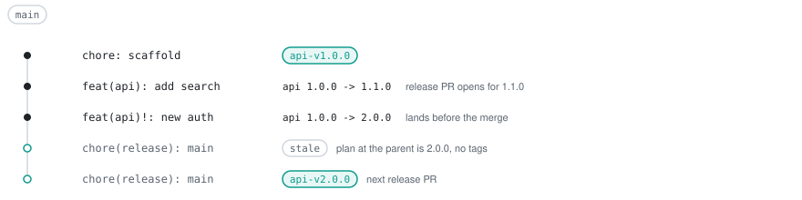
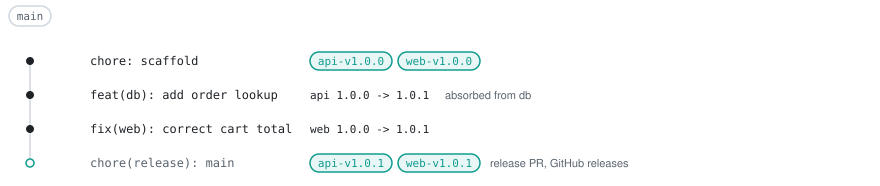
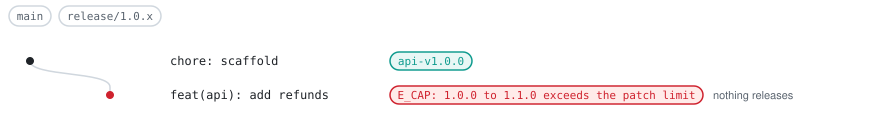
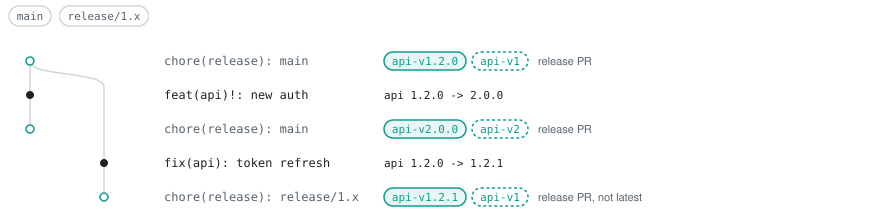
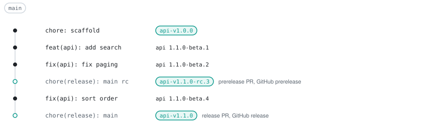
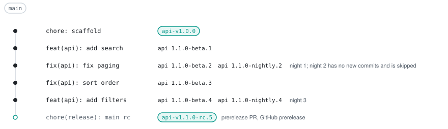
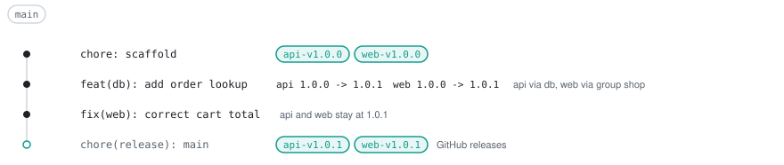

# Releasing

tallyrelease turns commits on a line branch into release PRs, tags and GitHub releases. The examples use the running example from [concepts.md](concepts.md).

## The release cycle

`tallyrelease run` runs on every push to a line branch. In order, it:

1. Reconciles merged release PRs: it tags every merged release PR labelled `tallyrelease: pending`, creates the GitHub releases and relabels the PR `tallyrelease: released`.
2. Plans HEAD.
3. Opens or updates the release PR on `tallyrelease/release/<branch>/shared` (or `tallyrelease/release/<branch>/<item>` for `releasePr: separate`), labelled `tallyrelease: pending`. The body holds one changelog section per unit.
4. Writes the plan and the outputs (`--out`, `--github-output`, `--summary`).

When a release PR is merged, the next run recomputes the plan at the first parent of the merge commit. If the versions still match the PR, the merge commit is tagged and the GitHub releases are created. Otherwise the PR is labelled `tallyrelease: stale` with a comment giving the reason, and nothing is tagged.

<p align="center">
  <picture>
    <source media="(prefers-color-scheme: dark)" srcset="assets/stale-release-pr-dark.svg">
    
  </picture>
</p>

<p align="center">
  <picture>
    <source media="(prefers-color-scheme: dark)" srcset="assets/release-pr-dark.svg">
    
  </picture>
</p>

`api` has no commit of its own after the scaffold; it absorbs the `db` change and gets a patch. `web` gets a patch from its own fix. A GitHub release is created for each tag.

## Versions from commits

Commits follow Conventional Commits. `feat` gives a minor bump, `fix`, `perf` and `revert` a patch, and a `!` after the type or a `BREAKING CHANGE` footer a major. Other types give no bump. `bumps.types` changes or extends this mapping. A `Release-As: <version>` footer sets the next version of the units the commit is attributed to. An unqualified footer in a commit without files applies to every released unit, so use the qualified form `Release-As: api@1.2.0` to set the version of `api` only. In a fixed group, a member's footer only raises the group version. While the major version is 0, breaking changes and `feat` give a minor bump (`bumps.preMajor.breaking` and `bumps.preMajor.feat` change this). A unit without a base tag gets its first release at `initialVersion`, or the scheme's initial version (`1.0.0` for semver).

`explain` shows how a unit's next version comes about. Here `api` has no commit of its own; the `feat` in `db` is absorbed and gives a patch:

```text
$ tallyrelease explain api --branch main
api  apps/api  node  semver
base    547e10f (merge base with main)

affected  dependent via db
release   1.0.0 -> 1.0.1 (patch)
  base tag api-v1.0.0

changes (1)
  acdcd7d  feat  add order lookup  via db
      packages/db/src/index.js
```

## Maintenance lines

A maintenance line keeps releasing fixes for an older major. Add a maintenance rule after the default rule:

```yaml
# tallyrelease.yaml
plugins:
  node: {}
units:
  apps/api: { release: true }
  apps/web: { release: true }
branches:
  - { name: main, line: default }
  - { name: "release/{major}.x", line: maintenance }
tags:
  floating: ["{id}-v{major}"]
```

Start the line by pushing the last release of the major as a branch: `git push origin api-v1.2.0:refs/heads/release/1.x`. When a release PR on the default line releases a new major and a maintenance rule with `{major}` and no `*` exists for the item, its body suggests this command. The branch needs the rule in its own `tallyrelease.yaml`, so add the rule before that release or commit it on the new branch.

On `release/{major}.x` a release may bump at most the minor version. A rule with `{minor}` caps at patch. A commit that would exceed the cap fails the plan with [`E_CAP`](errors.md#e_cap), so `run` fails before it opens a release PR. On `release/{major}.{minor}.x`, a `feat` fails like this:

```text
$ tallyrelease plan --branch release/1.0.x
error[E_CAP]: unit "api": 1.0.0 to 1.1.0 exceeds the patch limit of branch rule "release/{major}.{minor}.x"; commits: c4a2d21c89504a65bc9eba7a12ac1160f6c83171 add refunds (minor)
```

A `feat!` on `release/1.x` fails the same way against the minor limit.

<p align="center">
  <picture>
    <source media="(prefers-color-scheme: dark)" srcset="assets/cap-patch-dark.svg">
    
  </picture>
</p>

Floating tags move only when `tags.floating` is set. With `{id}-v{major}`, `api-v1` follows the highest 1.x release of `api` and never moves to 2.x. GitHub releases on a maintenance line are never marked latest.

<p align="center">
  <picture>
    <source media="(prefers-color-scheme: dark)" srcset="assets/maintenance-line-dark.svg">
    
  </picture>
</p>

`release/1.x` starts at the commit tagged `api-v1.2.0`. The breaking commit on `main` gives `api` 2.0.0, and the fix on `release/1.x` gives 1.2.1. With `tags.floating: ["{id}-v{major}"]`, `api-v1` moves to `api-v1.2.1` and `api-v2` points at `api-v2.0.0`. The GitHub release for `api-v1.2.1` is not marked latest. A later `feat(api)!` on `release/1.x` fails with `E_CAP`, so nothing releases.

## Prereleases

A rule with `channels.build` gives every push a build prerelease `{next}-{build}.{N}`. `N` is the number of first-parent commits since the line base, the highest stable tag of the unit on HEAD's first-parent chain; without one, since the unit's introduction. Two commits after `api-v1.0.0` and `web-v1.0.0`, both units build as `1.0.1-beta.2`:

```text
$ tallyrelease plan --base HEAD~2
branch  main (rule main, default line, channel beta)
base    547e10f (--base HEAD~2)

UNIT  KIND        FROM   BUMP   NEXT   VERSION
api   prerelease  1.0.0  patch  1.0.1  1.0.1-beta.2
web   prerelease  1.0.0  patch  1.0.1  1.0.1-beta.2

2 units planned: 2 prerelease
```

Build prereleases are not tagged and nothing is written. The commit sha identifies the build, and the release list hands the version to your publishers. tallyrelease needs no tag to find a build again: any later run recomputes its `N` from the first-parent history and the stable tags. A cut's `K` depends on the commit its PR was built on, so later runs read it only from the cut tag.

With `channels.cut`, `pr` (and `run`) also opens a prerelease PR on `tallyrelease/prerelease/<branch>/shared` (or `/<item>` for `releasePr: separate`), next to the release PR. It changes only changelogs. Merging it tags the merge commit `{next}-{cut}.{K}` and creates a GitHub prerelease. `K` is one more than the `N` of the commit the PR was built on. Once the stable release PR is merged, the next run closes open prerelease PRs.

```yaml
# tallyrelease.yaml
plugins:
  node: {}
units:
  apps/api: { release: true }
  apps/web: { release: true }
branches:
  - { name: main, line: default, channels: { build: beta, cut: rc } }
```

<p align="center">
  <picture>
    <source media="(prefers-color-scheme: dark)" srcset="assets/prereleases-dark.svg">
    
  </picture>
</p>

The prerelease PR was built on `fix(api): fix paging` (`N` = 2), so the cut is `1.1.0-rc.3`. The counter keeps running after the cut, so the next build is `1.1.0-beta.4`.

With nightlies (next section), a rule has up to three prerelease kinds:

| Prerelease | Made by                                                                                              | Version                | Tag and GitHub prerelease | Release list entry                                                              |
| :--------- | :--------------------------------------------------------------------------------------------------- | :--------------------- | :------------------------ | :------------------------------------------------------------------------------ |
| build      | every other run (push, dispatch, a `schedule` run on a rule without `channels.nightly`)              | `{next}-{build}.{N}`   | none                      | `tag: null`, `releaseSha` = HEAD; none when the unit is released or cut at HEAD |
| nightly    | a run with the nightly channel selected (`schedule` by default, `--channel`, `TALLYRELEASE_CHANNEL`) | `{next}-{nightly}.{N}` | none                      | as build                                                                        |
| cut        | merging a prerelease PR                                                                              | `{next}-{cut}.{K}`     | on the merge commit       | `tag` set, `releaseSha` = merge commit                                          |

### Nightly prereleases

A rule with `channels.nightly` can publish a nightly prerelease `{next}-{nightly}.{N}`. `N` is the same counter as for builds. Like a build, a nightly is not tagged and nothing is written. The distinct label keeps its version from colliding with the push build of the same commit.

<p align="center">
  <picture>
    <source media="(prefers-color-scheme: dark)" srcset="assets/nightly-dark.svg">
    
  </picture>
</p>

A nightly and a beta build share `N`, and a nightly includes every push build since the previous one.

```yaml
# tallyrelease.yaml
plugins:
  node: {}
units:
  apps/api: { release: true }
  apps/web: { release: true }
branches:
  - {
      name: main,
      line: default,
      channels: { build: beta, nightly: nightly, cut: rc },
    }
```

The channel is selected in this order:

1. `--channel <build|nightly>`.
2. `TALLYRELEASE_CHANNEL`.
3. `nightly` on a `schedule` event.
4. Otherwise `build`.

Preview a nightly locally with `--channel`. Two commits after `api-v1.0.0` and `web-v1.0.0`, both units render as `1.0.1-nightly.2`:

```text
$ tallyrelease plan --channel nightly --base HEAD~2
branch  main (rule main, default line, channel nightly)
base    547e10f (--base HEAD~2)

UNIT  KIND        FROM   BUMP   NEXT   VERSION
api   prerelease  1.0.0  patch  1.0.1  1.0.1-nightly.2
web   prerelease  1.0.0  patch  1.0.1  1.0.1-nightly.2

2 units planned: 2 prerelease
```

- A nightly run takes its [build base](ci.md#build-base) from the last successful scheduled or dispatched run of the workflow. Nights without new commits plan nothing.
- A `schedule` run on a rule without `channels.nightly` keeps the build channel.
- Selecting `nightly` with `--channel` or `TALLYRELEASE_CHANNEL` on such a rule fails with `E_CHANNEL_SELECT`.
- The cut channel must sort above the nightly channel, or `W_CHANNEL_ORDER` warns. `rc` sorts above `nightly`, `alpha` does not.
- `schedule` events run only on the default branch, so `channels.nightly` on a maintenance rule is never selected by a schedule.

The workflow is in [CI](ci.md#nightly-prereleases).

## Groups and absorbed units

A build-only unit's changes reach the released units that depend on it, and a fixed group releases its members with one version:

| Unit  | Kind       | Change                         | Result                                             |
| :---- | :--------- | :----------------------------- | :------------------------------------------------- |
| `db`  | build-only | `feat(db): add order lookup`   | rebuilt, never versioned                           |
| `api` | released   | absorbed from `db`             | 1.0.1 (patch, `bumps.absorbed` default)            |
| `web` | released   | `fix(web): correct cart total` | 1.0.1 (patch); with the group, released with `api` |

```yaml
# tallyrelease.yaml
plugins:
  node: {}
units:
  apps/api: { release: true }
  apps/web: { release: true }
branches:
  - { name: main, line: default }
groups:
  shop: { units: [api, web] }
```

With the group, `plan` shows the group of each member:

```text
$ tallyrelease plan --base HEAD~2
branch  main (rule main, default line)
base    547e10f (--base HEAD~2)

UNIT  GROUP  KIND     FROM   BUMP   NEXT   VERSION
db    -      rebuild  -      -      -      -
api   shop   rebuild  1.0.0  patch  1.0.1  -
web   shop   rebuild  1.0.0  patch  1.0.1  -

3 units planned: 3 rebuild
```

Without the `fix(web)` commit, `web` would still release 1.0.1 with `api`, with the changelog entry `Synchronize shop versions`.

<p align="center">
  <picture>
    <source media="(prefers-color-scheme: dark)" srcset="assets/group-dark.svg">
    
  </picture>
</p>

Each member still gets its own tag and, by default, its own GitHub release. To get one GitHub release for the whole group, set `releaseTag` on the group, a tag format with `{id}` (the group name) and `{version}`:

```yaml
groups:
  shop: { units: [api, web], releaseTag: "{id}-v{version}" }
```

Reconcile then also pushes `shop-v1.0.1` at the merge commit and creates one release `shop: v1.0.1` on it, with the changelog sections of `api` and `web`, each version heading naming its unit. Member tags, changelogs and floating tags stay as they are, and planning never reads the group tag. The tag must not render like a unit's `tagFormat`. Releases made before the setting keep their per-unit GitHub releases, which `plan` and `run` still report.

## Release PRs

By default all release items share one release PR on `tallyrelease/release/<branch>/shared`. `releasePr: separate` (in `defaults`, on an ungrouped unit or on a group) gives an item its own PR on `tallyrelease/release/<branch>/<item>`. The PR commit updates version files and changelogs. The body has one `<details>` section per unit with its changelog section, followed by a hidden marker with the planned versions, which reconcile compares on merge. When the changelogs are too long for a PR body, whole unit sections are left out with a note; the files in the PR hold all of it.

`pr --dry-run` prints the release PRs it would create, update or close, without pushing.

A stale merge leaves the release commit on the branch without tags. The next release PR adds one new changelog section per unit, above the section of the last release, with the versions of the new plan.

## Build versions

`tallyrelease version` writes the versions of the build at HEAD into the version files, templates and markers of the working tree. It writes no changelogs. Run it before the build, so the artifacts report the version that `run` releases for that commit. On a line with a build channel each pending unit gets its prerelease, for example `1.1.0-beta.4`. A merged release PR whose version files already hold `next` stays as it is. Known gap: a unit that was never released and still holds its initial version, such as `1.0.0`, counts as released at HEAD and keeps that version instead of the beta. On a line without a build channel nothing changes.

`version` plans HEAD without a build base and calls no forge, so it needs no token. It needs the full history for the prerelease number and fails with `E_BUILD_NUMBER_SHALLOW` in a shallow clone. Like `pr`, `release` and `run`, it does nothing on pull request events. It writes only the working tree, so it loads local plugins without `--allow-local-plugins`.

## What is not covered

tallyrelease does not publish to registries. `run --github-output` hands the release list to your publishers; [ci.md](ci.md) shows the workflow. Release effects (release PRs, tags, GitHub releases) work with GitHub only.
